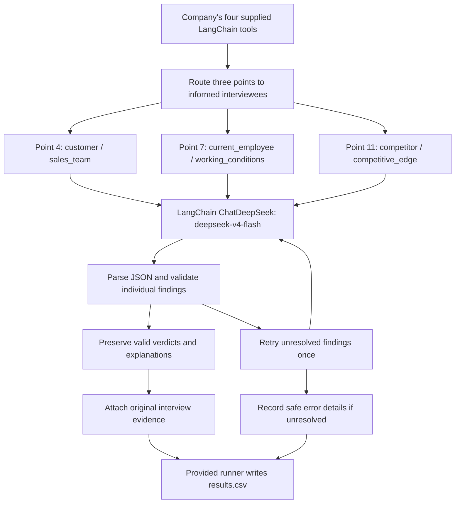

# FTEC5660 Homework 3: Fisher's 15-Point Investment Agent

Build a LangChain agent that researches a company with tools and applies the
framework from Philip Fisher's *Common Stocks and Uncommon Profits* (Part One,
Chapter 3 "What to buy: the fifteen points to look for in a common stock", and
Chapter 4 "What to buy: applying this to your own needs"). You choose 3 of
Fisher's 15 points and decide yourself what PASS means for each. For every
company your agent gives a PASS/FAIL verdict on your 3 points and a short
summary.

The companies are fictional, so the model cannot answer from memory. Unlike a
pile of reports, the evidence is spread over three sources, and your agent has
to go and get it with tools, the way Fisher's "scuttlebutt" method sends an
investor to talk to customers, competitors, suppliers and staff.

## Data and tools

`public_test/` has one folder per company. Your code receives four tools per
company (built by the provided code in `hw3.py`):

| Tool | What it gives you |
| --- | --- |
| `list_documents()` | the company's six documents and their dates |
| `read_document(name)` | one document: the 2025 letter to shareholders, four earnings calls (Q3 2025 to Q2 2026) and a news file (July 2025 to July 2026) |
| `sql_query(query)` | one read-only SQLite query on the company's database; at most 50 rows come back, so use `SUM`, `GROUP BY` and `WHERE` |
| `interview(role, topic)` | what one person says about the company; at most **10 interviews per company** |

The documents are what management says. Management's own claims (such as "we
have never cut research" or "our people are our greatest strength") are not
evidence on their own: check them against the database and the interviews.

**Database tables** (amounts in USD thousands; dates `YYYY-MM-DD`, months
`YYYY-MM`, quarters like `2025Q3`; the fiscal year is the calendar year):

| Table | Columns |
| --- | --- |
| `company` | name, industry |
| `industry_medians` | industry, revenue_growth_2y_pct, new_product_share_pct, new_product_sales_per_rd, operating_margin_pct (one row per industry; use the row for the company's own industry) |
| `orders` | order_id, order_date, product, customer, amount, note (about 3,000 to 4,000 orders from January 2023 to June 2026; revenue is the sum of order amounts) |
| `products` | product, launch_date |
| `monthly_costs` | month, cost_of_sales, selling_admin, research_development |
| `quarterly_cash` | quarter, operating_cash_flow, capex, cash_end |
| `capex_plan` | year, planned_capex (2026 to 2028) |
| `returns` | month, units_shipped, units_returned |
| `insider_trades` | trade_date, person, title, side (`buy` or `sell`), shares, price |

**Terms used in the data.**

| Term | Meaning |
| --- | --- |
| FY2025 | Fiscal year 2025. Here the fiscal year is the calendar year, so FY2025 is January to December 2025. |
| Quarter | Three months of the year: Q1 is January to March, Q2 April to June, Q3 July to September and Q4 October to December. The database writes `2025Q3`; the documents write "third quarter 2025". |
| Amounts | The database is in **USD thousands** (676,100 means US$676.1 million). The documents use USD millions. |
| Revenue | Money from sales: the sum of `amount` in `orders`. |
| Cost of sales | The cost of making the products that were sold. |
| Selling and admin | The cost of selling and of running the company (sales staff, offices, management). |
| R&D | Research and development spending, mainly on new products. |
| Operating margin | Operating profit as a share of revenue: (revenue − cost of sales − selling and admin − R&D) ÷ revenue. |
| Operating cash flow | Cash that the day-to-day business brings in during a quarter. |
| Cash at the end of a quarter | The cash the company holds on the last day of that quarter (`cash_end`). |
| Capex | Capital expenditure: spending on factories, machines and other long-term assets. `capex_plan` holds the planned capex for 2026 to 2028. |
| Return rate | Units returned ÷ units shipped, from the `returns` table. |
| Industry median | The middle value for companies in the same industry, from `industry_medians`. |
| Insider | A director or senior manager of the company. `insider_trades` lists the shares they bought (`buy`) or sold (`sell`). |
| Earnings call | A meeting each quarter where management presents the quarter's results to investors. Each call quotes that quarter's revenue. |

**Interviews.** Roles: `customer`, `current_employee`, `former_employee`,
`competitor`, `supplier`. Topics: `sales_team`, `working_conditions`,
`top_management`, `decision_making`, `competitive_edge`. Only some people know
about each topic; the others say they can't comment, and that answer still
uses up one interview.

| Topic | Who knows about it |
| --- | --- |
| `sales_team` | customer, competitor |
| `working_conditions` | current_employee, former_employee |
| `top_management` | former_employee, supplier |
| `decision_making` | supplier, customer |
| `competitive_edge` | competitor, customer |

People who know about a topic always agree with each other, so one good answer
is enough.

## Choose your 3 points and your rules

Pick any 3 of Fisher's 15 points and write them in `CHOSEN_POINTS` near the
top of `hw3.py`, e.g. `CHOSEN_POINTS = [1, 7, 15]`. The full questions are in
`FISHER_POINTS` in `hw3.py` and in the book.

| # | Fisher's point | Where the evidence is |
| --- | --- | --- |
| 1 | Market potential for sales growth | database |
| 2 | New products as current lines mature | database |
| 3 | Effective research and development | database |
| 4 | Above-average sales organization | interviews (`sales_team`) |
| 5 | Worthwhile profit margin | database |
| 6 | Maintaining or improving margins | database |
| 7 | Labour and personnel relations | interviews (`working_conditions`) |
| 8 | Executive relations | interviews (`top_management`) |
| 9 | Depth of management | interviews (`decision_making`) |
| 10 | Cost analysis and accounting controls | earnings calls, checked against the database |
| 11 | Advantage over competitors | interviews (`competitive_edge`) |
| 12 | Long-range outlook on profits | database |
| 13 | Growth without dilutive equity financing | database |
| 14 | Management talks freely about troubles | earnings calls, checked against the database |
| 15 | Management of unquestionable integrity | news file, checked against the database |

For each of your points, **you design the rule**: which evidence to use, what
to compute or whom to ask, and where the line between PASS and FAIL lies. PASS
means the company looks favourable on that point, as Fisher would see it.

We grade your verdicts against our own answer key. It uses one fixed rule per
point, which we do not publish, and the data never puts a company close to
the line of that rule, so a sensible reading of Fisher usually gives the same
answer. **Test your rules on the public answers**:
`public_test/ground_truth.json` gives the expected verdict on all 15 points
for each of the 20 public companies, and every point fails in 6 of them. If
your rule disagrees with the public answers, rethink it.

**Tip: calculate with tools, not in your head.** Do every sum, ratio and
comparison in SQL or Python, including the number of days between two dates
(SQLite's `julianday()` gives a date as a number of days).

## Student task

Fill in the three places in `hw3.py` marked `### YOUR CODE HERE`. You may add
imports, constants and helper functions above them, but do not change the
provided code below them:

- `CHOSEN_POINTS` lists your 3 points.
- `build_agent()` creates your model and anything else you need once.
- `analyze_companies(agent, companies)` receives
  `{company_folder: [list_documents, read_document, sql_query, interview]}`
  and returns, for every company,
  `{"points": {1: "PASS", 7: "FAIL", 15: "PASS"}, "summary": "..."}` (here with
  `CHOSEN_POINTS = [1, 7, 15]`).

Use the course techniques that fit your points: tool use for the database and
the interviews, planning which interviews to spend, routing each point to the
right source, prompt chaining, parallel calls, reflection to check your
answers, or a combination. Your code must read company data **only through
the four tools**; do not open `company.db` or `interviews.dat` yourself. Do
not hard-code folder names, company names or the public answers.

## Setup and public test

```bash
python3 -m venv .venv
source .venv/bin/activate
pip install -r requirements.txt
echo "DEEPSEEK_API_KEY=your_key_here" > .env
python3 hw3.py --data-folder public_test
```

Use your own DeepSeek API key (from https://platform.deepseek.com). The
required model is `deepseek-v4-flash`. We grade with our own key, so never put
a key in your code; `.env` must stay out of git.

The program creates `results.csv` with the columns `company`, `points`,
`points_correct`, `point_errors`, `interviews_used` and `summary`, and prints
the point score on your 3 points (the percentage after "balanced"). The point
score is the average of two shares: the share of truly passing verdicts that
you marked PASS and the share of truly failing verdicts that you marked FAIL.
For example, 90% and 60% give (90% + 60%) / 2 = 75%, and marking every point
PASS gives (100% + 0%) / 2 = 50%. Once `CHOSEN_POINTS` is set, the starter
runs before you add any API code (it returns no verdicts, so it scores 0%).

`public_test/ground_truth.json` gives the expected verdicts on all 15 points
for each public company. Grading uses a private set of about 20 unseen
companies with the same tools and the same answer key rules, but different
names and wording, and scores your 3 points only.

## Homework 3 solution

### My 3 points and rules

I selected Fisher points **4, 7 and 11**. They assess sales capability, employee relations and competitive position through direct stakeholder interviews. Each has a clearly identified knowledgeable interviewee, so three interviews per company provide relevant evidence while staying below the ten-interview limit. This follows Fisher's scuttlebutt approach and avoids the arithmetic and reporting-period risks associated with financial calculations. Points 8 and 9 are also reasonable alternatives; I do not claim that this selection is empirically superior to them because no comparative model benchmark was run.

| Point | Why I chose it | Evidence | PASS / FAIL rule |
| --- | --- | --- | --- |
| 4: Above-average sales organization | Customers can directly describe whether sales staff provide practical expertise and support. | `interview(role="customer", topic="sales_team")` | PASS when the interview describes knowledgeable, proactive support beyond merely quoting prices. FAIL when it describes weak product knowledge, inadequate advice or price-list-only service. |
| 7: Labour and personnel relations | Employees provide direct evidence of treatment, working conditions and staff stability. | `interview(role="current_employee", topic="working_conditions")` | PASS when the evidence supports fair treatment, constructive working conditions and stable personnel relations. FAIL for material weaknesses such as persistent excessive overtime, poor morale, unresolved grievances or high turnover. |
| 11: Advantage over competitors | Competitors can describe differentiation and the difficulty of winning or retaining the company's customers. | `interview(role="competitor", topic="competitive_edge")` | PASS for meaningful differentiation, hard-to-copy capabilities, switching barriers or strong customer retention. FAIL for interchangeable products, easy imitation or price-only competition. |

The provided data specification states that knowledgeable interviewees agree, so one informed interview per topic is sufficient for this assignment. This is a property of the supplied dataset, rather than a general assumption about real-world investment research. The rules are applied to the meaning of the full interview, including negation, rather than to a list of keywords.

### Design



The agent uses a fixed interview plan and retrieves evidence only through the supplied tools. It sends the three interviews and point-specific rules to `deepseek-v4-flash` through LangChain, requesting JSON verdicts and explanations. Interview text is treated as untrusted evidence rather than instructions. The program validates each finding separately, preserves successful findings, and retries unresolved findings once. Original interview text is attached directly to the summary, avoiding fragile exact-match checks on model-generated quotations. Up to three companies are processed concurrently. Tool/API failures are isolated per company and reported using exception types and HTTP status codes, without raw error messages or credentials. Unresolved points remain missing and are counted as incorrect by the original scorer; they are not converted into fabricated FAIL verdicts. The supplied tools, runner and scoring code are unchanged. The analysis code does not read the answer key or access company files directly.

### Results

The revised agent was run on the 20 public companies in Colab. The resulting `results (1).csv` was independently compared with the supplied `public_test/ground_truth.json`.

| Metric | Result |
| --- | --- |
| Companies evaluated | 20 |
| Point 4 correct | 20 / 20 |
| Point 7 correct | 20 / 20 |
| Point 11 correct | 20 / 20 |
| Total correct verdicts | 60 / 60 |
| True-PASS verdicts correctly classified | 42 / 42 |
| True-FAIL verdicts correctly classified | 18 / 18 |
| Balanced accuracy | **100%** |
| Companies with disagreements | None |
| Missing verdicts or recorded errors | 0 |
| Interviews used | 3 per company; 60 total |

Balanced accuracy is the mean of PASS recall and FAIL recall: `(42/42 + 18/18) / 2 = 100%`. There are no public-test disagreements to explain. The summaries contain evidence and explanations for both PASS and FAIL decisions, so this result is not an all-one-class fallback. This reports one successful public-test run, not an average of three runs or a guarantee of performance on private companies. No comparative API test was conducted for points 8 and 9.

### Reproduction and credentials

Install the packages in `requirements.txt`, configure `DEEPSEEK_API_KEY` privately, and run:

```bash
python3 hw3.py --data-folder public_test
```

For Colab, use the accompanying notebook and store the key in Colab Secrets under `DEEPSEEK_API_KEY`, with notebook access enabled. The notebook passes it to the process environment. Never commit an API key or `.env`. The required model remains `deepseek-v4-flash`; no alternative model or external company data source is used.
